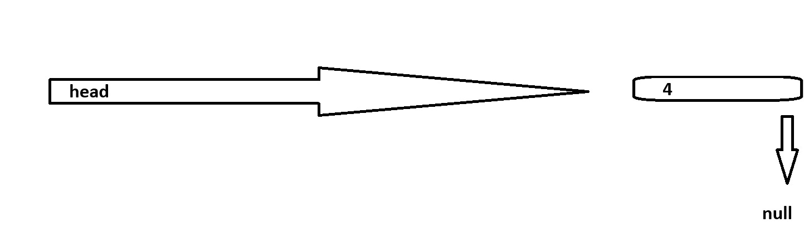
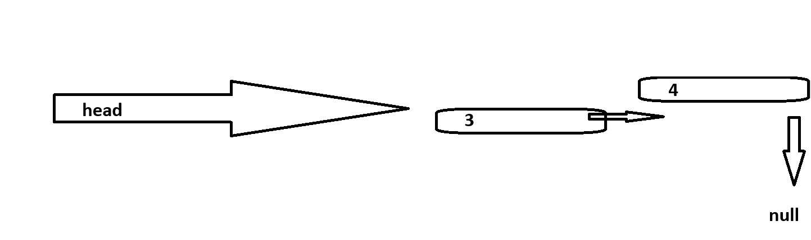
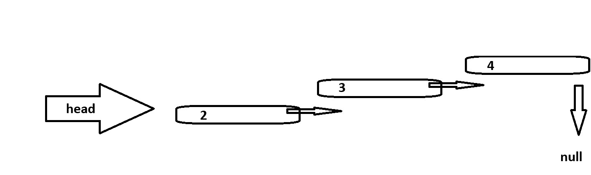
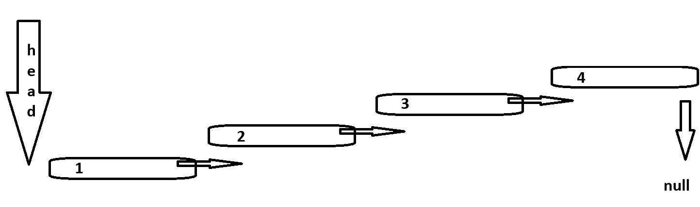

# Memory Management

D Mullier 11/2026

## Overview

* Linked Lists
* Dynamic Memory Allocation
* Memory Deallocation
* Alternative methods of allocation
* Automated Garbage Collection

---
## Linked Lists
* Linked lists are a common data structure. 
* They are extremely memory efficient in terms of memory, whereas arrays are not. 
* The idea is each data item is linked to the next
* We can therefore add a new data item as it is needed 
  * unlike an array where we need to allocated its maximum size when it is defined
  
---
## A Boat Analogy
* Think of a lot of boats tied together on a river
  * each boat has a rope, the lead boat is tied to the quayside (mooring)
  * the next boat is tied to the lead boat, etc
* as each customer comes along 
  * the boat tied to the mooring is united from the boat behind and the mooring
  * the boat behind is tied to the quayside
  * the lead boat is now free to go with the customer (and the formerly behind boat is now the lead boat)
* If we needed to get to the last boat (or any intermediate boat)
  * we can get to it by hopping from one boat to the next


* This is how a linked list works!

---
## Processing the linked list
* We can now image how a linked list is processed
* If we want to process any data item
  * we proceed from the head (the mooring) and traverse each node/boat via the pointer/rope
  * we can do this because each boat is tied (each node has a pointer pointing to) the next
* The linked list can implement many different data structures
 * a queue (a boat added to the end would be used last)
 * a stack (a boat added to the beginning would be used first)
* It only ever needs the minimal amount of memory
  * but finding an item requires traversing along the list sequentially
* An array must be big enough to cope with the worst case, but it can be accessed with "random access"
  * Linked list = smaller but slower, array = bigger but faster
  
---
see [rowing_boat_linked_list.c example](rowing_boat_linked_list.c)
```c++
struct Boat
{
    int id;
    struct Boat *next;
};
```
```c++
struct Boat *head = NULL;
    int number;
    printf("How many boats? ");
    scanf("%d", &number);
    while (number>0)
    {
            struct Boat *newBoat = malloc(sizeof(struct Boat)); //allocate memory for a new boat
            newBoat->id = number;
            number--;
            newBoat->next = head; //connect the rope of the new boat to what is currently connected to head
            head = newBoat;
    }
```
---
* iteration 1

  

---
* iteration 2

  

---
* iteration 3
 
  

---
* iteration 4

  

---
## Memory within Programs

* When a program is running, it uses memory to store data, e.g. in variables.
* Much of this memory is managed for us. For example, when we create a variable in our code, we do not have to manually arrange for the memory to be available.
* Also, when we call a function, the parameters passed are stored in memory and handled automatically.
* In many programs, however, the exact number of values we are going to store is only known once the program is actually running.
* For example, if a program reads some data from a file, how much memory should be allocated to store that data? Or, if we were creating a system to manage customers, how many customers will we need to store information about?


* One solution could be to create very large arrays, but this would be very wasteful of memory if the amount of storage actually required was low.

---

## Types of Memory

* When a program is executing, local variables and parameters are managed using **Stack memory**.
* The stack is used to store values which are typically only required on a temporary basis, and its usage is automatically managed.
* However, in many cases we want to manage our own memory usage, especially when developing systems that use memory in a more dynamic fashion.
* For this purpose we use **Heap memory**, which is a chunk of memory managed by the OS.
* When programming in C we can explicitly request, and later relinquish, portions of Heap memory as and when they are required using function calls provided as part of the C standard library.

---

## Allocating Memory

* There are a number of related functions that allow us to explicitly request a block of memory by specifying how many bytes we require.
* They then typically return a pointer (a memory address) to the first byte of the requested memory.
* The most commonly used C function for this purpose is `malloc()`.
* When calling `malloc()` we often use `sizeof()` to help calculate the correct number of bytes required, e.g.:

```c
// request a block of memory large enough to store 1000 integers
int *my_list = malloc(sizeof(int) * 1000);

```

---

## Deallocating Memory

* Once we no longer need previously requested memory, we must relinquish this to ensure it becomes available for other uses. If we forget, **memory leaks** can occur.
* We do this by calling the `free()` function, passing in the pointer to the memory we no longer need, e.g.:

```c
free(my_list); // frees the memory previously allocated

```

* Once `free()` is called the memory is no longer allocated, although the pointer still refers to the memory location.
* One of the most common forms of bugs in C programs is accessing a pointer to a block of memory no longer actually owned, so it is good practice to set pointers to `NULL` once their memory has been freed.

---

## Clearing Memory during Allocation

* When allocating memory using the `malloc()` function, the returned memory block remains uninitialised (containing old data).
* In certain circumstances it is appropriate to allocate memory which is explicitly initialised to zero.
* We can do this using a call to the `calloc()` function, which takes two parameters: the number of items required and the size of each item, e.g.:

```c
// request a block of zero'd memory large enough for 1000 integers
int *my_list = calloc(1000, sizeof(int));

```

---

## Reallocating Memory

* One of the reasons we use dynamic memory allocation is to allow the size of the memory we use to expand or contract.
* Unlike an array, which is fixed-sized, memory allocated using calls to `malloc`/`calloc` can be resized by calling the `realloc()` function.
* This function 'sometimes' needs to copy existing data to a new memory location, so it is important to always update the original pointer to the value returned, e.g.:

```c
// reallocate a block of existing memory, so it can store 2000 integers
my_list = realloc(my_list, sizeof(int) * 2000); // note: assign back to same ptr

```

---

## Dealing with Out of Memory Conditions

* The provided allocation functions return a pointer to the block of allocated memory, but they can also return `NULL` if the requested memory could not be allocated.
* Hence, code should always check if the returned value is `NULL` before any attempt is made to use the value (e.g., to dereference the pointer).
* *Note:* Not all operating systems will actually return `NULL` if memory is low. For example, Linux never returns `NULL`; if a program requests a massive amount of memory under Linux, the Out of Memory Killer (OOM Killer) simply kills a process, and not always the one that made the request!

---

## A Worked Example: Linked Lists

* Dynamic Memory Allocation is often used to store values in Data Structures, such as a **linked list**, allowing the creation of an extendible list of values without using an array.
* Such data structures often store values based on compound types, usually defined as `struct` types.
* Each time a new value needs appending to the list, `malloc()` is used to allocate memory; when removed, `free()` is used.

### Defining the Structs

```c
struct stock_item{
   int id;
   float price;
   unsigned stock_level;
};

struct element{
   struct stock_item item;  // the stock item being stored
   struct element *next;   // ptr to next 'element' on the list
};

```

### Adding to a Linked List

```c
struct element * add_stock_item(struct element *element, struct stock_item item){
   // allocate memory for the element
   struct element *new_element = malloc(sizeof(struct element));
   new_element->item = item;   // copy the item (using -> to deference the ptr)
   new_element->next = element;   // set 'next' to point at existing element
   return new_element;
}

```

### Printing a Linked List

```c
void print_stock_list(struct element *element){
   while (element)
   {
       struct stock_item item = element->item; // get the next item
       printf("Stock ID: %d, price: %.2f, level: %u\n", item.id, item.price, item.stock_level);
       element = element->next; // move to next element
   }
}

```

### Clearing a Linked List

```c
void clear_stock_list(struct element *element){
   while(element) {
       // get the 'next' element, prior to freeing memory
       struct element *next = element->next;
       free(element);  // deallocate the memory
       element = next; // move to next element
   }
}

```

### Using the Linked List

```c
struct element *head = NULL;

// add stock items
head = add_stock_item(head, (struct stock_item){1, 1.45, 1000});
head = add_stock_item(head, (struct stock_item){2, 2.55, 500});
head = add_stock_item(head, (struct stock_item){2, 2.55, 500});

// use the list
print_stock_list(head);
clear_stock_list(head);  // free the list contents once done
head = NULL;             // set head to NULL for safety!

```

---

## Checking for Memory Leaks

* Dynamic analysis tools like **valgrind** can identify memory leaks if we forget to call functions like `clear_stock_list()`, even showing the exact line numbers where the leak occurred.


---

## Garbage Collection

* Many modern languages allow dynamic allocation of memory, but the programmer is not typically responsible for explicitly releasing that memory.
* This is done using a feature known as **automatic Garbage Collection (GC)**.
* While much safer, GC tends to have overhead in terms of performance and can result in "embarrassing pauses" while it identifies and releases large chunks of memory.
* **C does not support Garbage Collection**, making memory management entirely the responsibility of the programmer.

---

## Points to Note & Summary

* **Dynamic memory allocation is powerful, but dangerous!**


* Always ensure you `free()` memory which has been allocated.


* Be careful not to access pointers to memory you no longer own; set pointers to `NULL` if required.


* Only use `calloc()` if the memory really does need initialising to zero.


* Always check the value returned from `malloc()`, etc., to ensure it is not `NULL`.


* Use dynamic analysis tools such as `valgrind` to ensure your code has no memory leaks and does not attempt to `free()` the same memory more than once.


* Programs make use of two distinct types of memory: **Stack memory** and **Heap memory**.